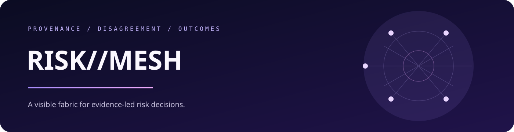

<p align="center">
  
</p>

<p align="center">
  <a href="https://jeevan-0508.github.io/Risk-Mesh/observatory/">Open the Observatory</a> ·
  <a href="docs/MESH_ARCHITECTURE.md">Architecture</a> ·
  <a href="docs/INTEGRATION_MATRIX.md">Capability status</a> ·
  <a href="docs/getting-started.md">Technical docs</a>
</p>

# RISK//MESH

### A provenance-led fabric connecting evidence, models, investigations, decisions, and outcomes.

RISK//MESH is the connective layer around a risk portfolio. It keeps the source, confidence, disagreement, and freshness of each signal visible while turning completed checks into a briefing a human can inspect.

`PROVENANCE-FIRST` · `DETERMINISTIC BRIEFING` · `VISIBLE UNCERTAINTY` · `GITHUB PAGES`

## Start with the live experience

The **[Observatory](https://jeevan-0508.github.io/Risk-Mesh/observatory/)** is the product surface: a neural particle-orb, ledger replay, and provenance-labelled briefing that explains what changed across the connected systems.

It is intentionally a snapshot, not browser-side live telemetry. The page tells you whether a source is `SNAPSHOT`, `SIMULATED`, `UNAVAILABLE`, or genuinely `LIVE`.

## What you can inspect

<table>
  <tr>
    <td width="50%"><strong>Signal lineage</strong><br>Follow a finding back to the source that produced it and the adapter that interpreted it.</td>
    <td width="50%"><strong>Disagreement</strong><br>Keep competing explanations visible instead of compressing them into an unexplained score.</td>
  </tr>
  <tr>
    <td width="50%"><strong>Decision context</strong><br>See how evidence, investigations, and outcomes connect across the portfolio.</td>
    <td width="50%"><strong>Freshness</strong><br>Understand when a briefing was generated and whether the underlying source is current.</td>
  </tr>
</table>

## The surrounding systems

[POLICY//AUDIT](https://jeevan-0508.github.io/policy-audit/) traces governance evidence. [RISK//SWARM](https://jeevan-0508.github.io/risk-swarm/) makes agent disagreement inspectable. [RISK//REPLAY](https://jeevan-0508.github.io/risk-replay/) lets you replay a decision. [Fraud Watch](https://jeevan-0508.github.io/fraud-watch/) supplies a living freight-risk world.

<details>
<summary><strong>How it stays honest</strong></summary>

The daily state check validates adapters, rebuilds the briefing, and refreshes the generated capability registry only when meaningful source or registry changes exist. It does not promote `SNAPSHOT`, `SIMULATED`, or `UNAVAILABLE` sources to `LIVE`.

</details>

<details>
<summary><strong>Developer notes</strong></summary>

See [the architecture note](docs/MESH_ARCHITECTURE.md) for boundaries and [the integration matrix](docs/INTEGRATION_MATRIX.md) for current capability evidence. The repository is designed as a transparent portfolio demonstrator, not a production telemetry platform.

</details>

## Local development

```bash
bun install
bun run dev
```

The repository currently does not bundle a static application screenshot; the live Observatory above is the source of truth for its visual state.

<p align="center"><sub>Built by <a href="https://github.com/Jeevan-0508">Jeevan Siddhabhaktula</a> · MIT licensed</sub></p>
